# 05-Practical Semantic Segmentation of Waste Classification Based on yolo11-seg

## 1. Data phase

### 1.1 Data Set Preparation

Waste classification **semantic segmentation** dataset consists of 947 manually labeled images, comprising 22630 annotated objects, categorized into four categories: **cardboard**, **hard plastic**, **metal**, and **soft plastic**. The images depict various scenarios of classified waste.

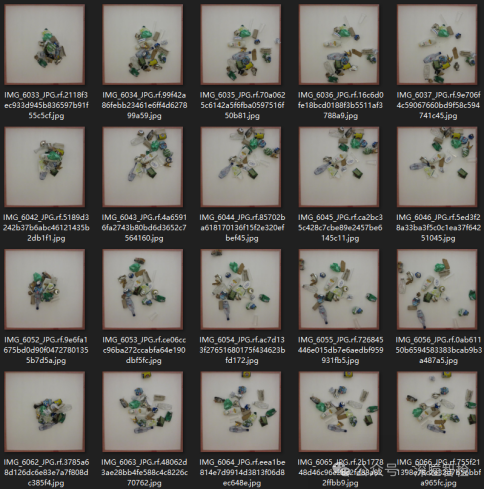

Dataset Introduction: The increase in global waste production poses significant threats to both human and environmental health. To address this issue, it is necessary to implement resource-friendly waste sorting and efficient recycling of recyclable materials. The application of convolutional neural networks has shown great potential, particularly in the separation of various types of waste.

1.2 Dataset Division

Waste waste classification **semantic segmentation** dataset, divided into training set, validation set and test set according to the corresponding proportions, and organized the directory structure required by the yolo algorithm. Finally, obtain the **yolo format** of the **semantic segmentation labels**, the specific directory structure is as follows:

★ Its structure is as follows (the training set is divided into **enhanced** version and **non-enhanced** version):

**waste_seg_yolo******

**- train******

**- - augmented******

**- -**** -**** images******

**- -**** -**** labels******

**- - unaugmented******

**- -**** -**** images******

**- -**** -**** labels******

**- ****test******

**- - images******

**- - labels******

**- ****valid******

**- - images******

**- - labels******

[Note: The "waste_seg_yolo" folder, which is prepared, should be placed in the same directory level as the following project "yolov11_seg", and it should not be placed inside the project.]

☆ You can directly obtain the converted Yolo format dataset (as shown in the following figure) by **seeing the end of this document**.

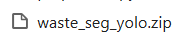

### 1.3 Environmental Installation

Installation command: pip install ultralytics==8.3.59 -i https://pypi.tuna.tsinghua.edu.cn/simple

## 2. Training phase

### 2.1 Start Training

Prerequisites: CUDA, Torch, and Ultralytics versions must be compatible and available. Use the Yolo11-Seg **m** model pre-trained version.

[Need to enter the project "yolov11_seg"]

Modify the data configuration file `./custom.yaml`, setting the training and validation sets paths, ensuring there is a consistent number of categories and category names.

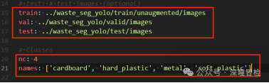

--- Execute training command: python train.py

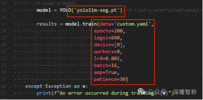

Modify the training parameters in the train.py file as needed, such as: for Windows systems, set workers to 0; for Linux systems, set it to 8.

After training 200 epochs (with early stopping mechanism, 200 epochs), the model is saved in the runs/segment/train/weights folder.

### 2.2 Results Display

2.2-1 F1_curve.png (F1 score)

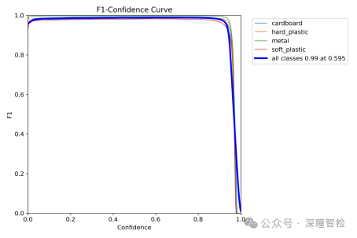

As shown in the figure, when confidence is 0.595, the F1 score of all classes is 0.99; this indicates that the model performs well overall at predicting classes with a confidence level of 0.595, demonstrating certain accuracy and recall.

What is the F1 score? The F1 score is the harmonic mean of precision and recall, taking into account both the accuracy of model predictions and their coverage.

2.2-2, P_curve.png (Accuracy Curve)

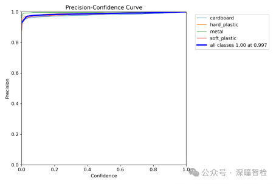

The deep blue line in the figure represents the overall accuracy, which increases with increasing confidence. At a confidence level of 0.997, the accuracy reaches 1. The other four lines represent the accuracy for each category at different confidence levels.

Precision curve, which helps analyze the model's performance in detection tasks, especially under different confidence settings. By this curve, a suitable confidence threshold can be selected to optimize the model's detection results, balancing precision and recall.

2.2-3 PR_curve.png (Precision-Recall Curve)

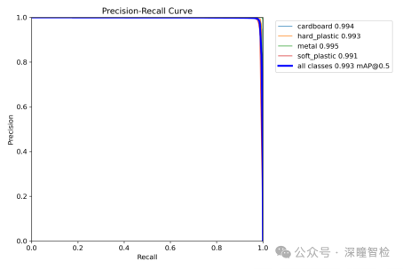

The curve in the image represents the Precision-Recall Curve (Precision-Recall Curve), which shows the precision and recall of the classifier at different thresholds. Specifically, the horizontal axis represents Recall (recall rate), ranging from 0.0 to 1.0; the vertical axis represents Precision (precision rate), ranging from 0.0 to 1.0. The main two curves in the image are:

(1) The color lines represent the precision-recall curves of four categories, with varying precisions for each category.

(2) The deep blue line represents the average precision-recall curve for all categories, with precision also stabilizing around 0.993.

Both curves show a slight decrease in precision as recall increases, but overall, the precision remains at a very high level.

This curve can evaluate the overall performance of the model in the target detection task and find an appropriate confidence threshold to achieve the best balance between precision and recall. The closer the PR curve is to the upper right corner, the better the model performs, and the larger the area under the curve, indicating that the model performs more consistently across different confidence levels.

2.2-4, R_curve.png (Recall Curve)

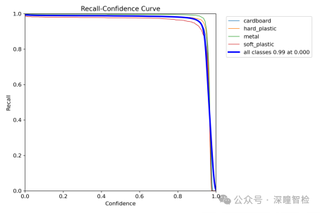

The R curve in the diagram represents the Recall-Confidence Curve (Recall-Confidence Curve), which shows the recall rate at different confidence levels. Specifically, the horizontal axis represents confidence levels, ranging from 0.0 to 1.0; the vertical axis represents recall rates, ranging from 0.0 to 1.0. The main five curves in the diagram are:

(1) Four color lines: Recall rates for four categories as a function of confidence. This curve shows that the recall rate for each category initially changes less with increasing confidence, then rapidly decreases after a certain point.

(2) Deep blue line: Represents the average recall rate of all categories as a function of confidence.

Display the recall performance of the model under different confidence thresholds. The recall curve aids in evaluating the model's ability to detect true targets in a target detection task. By analyzing this curve, users can assess the model's detection capabilities and analyze whether the model is comprehensively detecting true targets at varying thresholds. If the recall curve performs well at lower confidence levels, it indicates that the model can effectively detect most targets; if the curve declines rapidly, adjustments to the model or dataset may be necessary to avoid missed detection issues.

2.2-5, Results.png (Result Metric Curve)

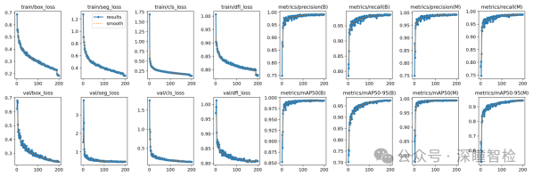

This image illustrates the changes in multiple metrics during the training and validation processes of the segmentation algorithm (seg) based on YOLOv11. Below are analyses of the meanings of each metric and trends shown in the image:

**Training phase** (First line)

train/box_loss:

Meaning: Bounding box regression loss, measuring the difference between the predicted bounding box and the ground truth bounding box.

Trend: The loss value decreases gradually with the increase of training iterations, indicating that the model is gradually optimizing in bounding box prediction.

train/seg_loss:

Meaning: Segmentation loss, measuring the difference between the segmentation mask and the true mask.

Trend: The rapid decrease in loss values indicates that the model is gradually converging on the segmentation task.

train/cls_loss:

Meaning: Category loss, measuring the gap between predicted and actual categories.

Trend: Decrease in loss values, indicating that the model is gradually optimizing for classification tasks.

train/dfl_loss:

Meaning: Distribution Focal Loss, used to improve the precision of bounding box regression.

Trend: The decrease in loss values indicates that the model is gradually optimizing its precision in bounding box regression.

metrics/precision(B):

Meaning: Precision, which measures how many true positives are predicted by the model for positive samples (for bounding box tasks).

Trend: The accuracy rate is gradually increasing and stabilizing, indicating that the model performs well in reducing false positives.

metrics/recall(B):

Meaning: Recall, which measures how many true positives are predicted by the model in the positive samples (for boundary box tasks).

Trend: The rapid increase and stabilization of recall rates indicate that the model maintains high accuracy while detecting more genuine targets.

metrics/precision(M):

Meaning: Precision, for the segmentation mask task.

Trend: The accuracy gradually increases and stabilizes, indicating that the model has reduced false positives in segmentation tasks.

metrics/recall(M):

Meaning: Recall, for the segmentation mask task.

Trend: The rapid increase and stabilization of recall rates indicate that the model can detect more true targets in segmentation tasks.

**Verification phase** (second line)

val/box_loss:

Meaning: Bounding box regression loss on the validation set.

Trend: The decrease in loss value indicates that the model's bounding box prediction performance is gradually optimized on the validation set.

val/seg_loss:

Meaning: Segmentation loss on the validation set.

Trend: The rapid decrease in loss values indicates that the model's segmentation performance is gradually optimized on the validation set.

val/cls_loss:

Meaning: Classification loss on the validation set.

Trend: The decrease in loss values indicates that the model's classification performance is gradually optimized on the validation set.

val/dfl_loss:

Meaning: Distributed Focus Loss on the validation set.

Trend: The decrease in loss values indicates that the model's boundary box regression accuracy is gradually optimized on the validation set.

metrics/mAP50(B):

Mean Average Precision (mAP) at IoU=0.5 for bounding box tasks.

Trend: mAP50 rapidly increases and tends to stabilize, indicating that the model has good overall detection performance in bounding box tasks.

metrics/mAP50-95(B):

Mean Average Precision (mAP) for bounding box tasks when IoU=0.5 to 0.95.

Trend: mAP50-95 gradually increases and stabilizes, indicating that the detection performance of the model under different IoU thresholds is gradually optimized.

metrics/mAP50(M):

Mean Average Precision (mAP) at IoU=0.5 for segmentation masking task.

Trend: mAP50 rapidly increases and tends to stabilize, indicating that the model performs well overall on segmentation tasks.

metrics/mAP50-95(M):

Mean Average Precision (mAP) for segmentation masking task when IoU=0.5 to 0.95.

Trend: mAP50-95 gradually increases and stabilizes, indicating that the segmentation performance of the model under different IoU thresholds is gradually optimized.

[Summary]

Training phase: All loss functions (box_loss, seg_loss, cls_loss, dfl_loss) show a downward trend, indicating that the model is gradually converging during training. At the same time, precision and recall rates are gradually increasing and stabilizing, suggesting that the model's detection and segmentation performance is good.

## 3. Inference phase

Predict using the trained model (input test image folder input_test_images):

python detect.py

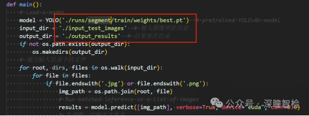

After the test is completed, the results are saved in the output_results folder. The example output is as follows:

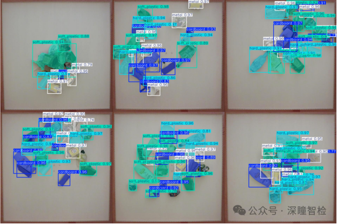

## Payment

Here is a pay link on Stripe ( https://buy.stripe.com/3cs8yP7sY87d0vu9AB ). Please contact me lonlonago@foxmail.com after funding $89, and I will send you a complete data files , thank you!

